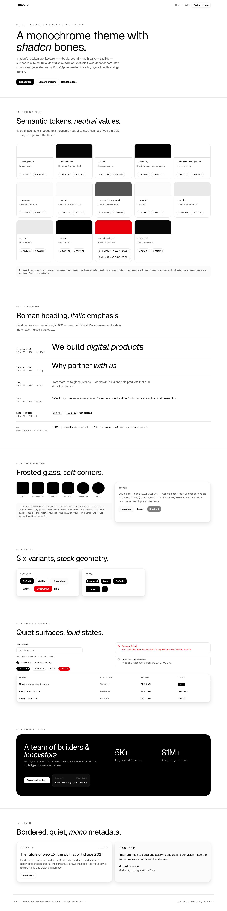
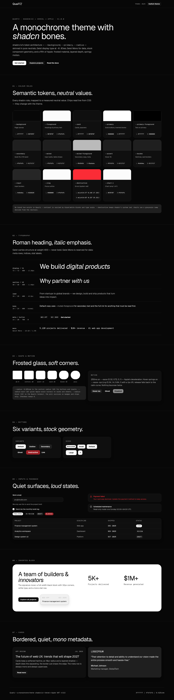

# Quartz

**An industrial-grade monochrome theme** — shadcn/ui token architecture,
Vercel's Geist type, Apple material. Zero hue, light + dark, WCAG AA verified.





## The blend

| Share | Layer | What it contributes |
|---|---|---|
| 40% | **Type** — Geist / Geist Mono | The face; Quartz keeps the rules: 400 headings, 700 buttons, one italic word, −0.03em display tracking, mono for data |
| 40% | **Components** — shadcn/ui | Token architecture (`:root` / `.dark`, semantic roles), `h-9` controls, ring focus, alpha hovers, pill badges |
| 20% | **Material** — Apple | Frosted glass (80% floor), layered shadows, 10/18/32px radius scale, 250ms deceleration, springy hover |

No brand hue exists. Contrast is carried by black/white blocks and type
scale. `--destructive` (system red) is the only colour in the system.

## What's inside

| File | Role |
|---|---|
| [`quartz.html`](quartz.html) | The full look — every token, type level, radius and component on one page. Open it in a browser. |
| [`quartz-tokens.css`](quartz-tokens.css) | Tokens only — one `:root`, one `.dark`. No component rules. |
| [`DESIGN.md`](DESIGN.md) | The complete design system: colour tables with measured contrast, type scale, shape & motion, component mapping, Tailwind v4 wiring, dos/don'ts, audit appendix. |
| [`SKILL.md`](SKILL.md) | The same system as a skill an LLM can follow to design and build UIs. |

## Quick start

**Direct:** open `quartz.html` — no build step.

**Tailwind v4:** import the tokens and wire the theme:

```css
@import "tailwindcss";
@import "./quartz-tokens.css";

@theme inline {
  --color-background: var(--background);
  --color-foreground: var(--foreground);
  --color-primary: var(--primary);
  --color-primary-foreground: var(--primary-foreground);
  /* …full mapping in DESIGN.md §6 */
  --radius-lg: var(--radius);        /* 10px — controls */
  --radius-xl: var(--radius-card);   /* 18px — cards */
  --font-sans: "Geist", -apple-system, BlinkMacSystemFont, ui-sans-serif, system-ui, sans-serif;
  --font-mono: "Geist Mono", ui-monospace, SFMono-Regular, Menlo, monospace;
}
```

Dark mode switches on the **`.dark` class**.

**Fonts** (italics required — the emphasis rule depends on them):

```html
<link rel="stylesheet" href="https://fonts.googleapis.com/css2?family=Geist:ital,wght@0,100..900;1,100..900&family=Geist+Mono:wght@100..900&display=swap">
```

## Rules that make it Quartz

- Headings are **weight 400** with −0.03em tracking — emphasis is *one italic
  word*, never bold.
- Every button label is **700** at 10px radius, `h-9` height, ring focus.
- Radius scale: **6** checkbox / **10** control / **14** alert / **18** card /
  **32** inverted block / **pill** badges only.
- Cards separate with `--shadow-md` layered depth; hairlines only draw the
  edge (`border/60%`).
- Sticky chrome and outline buttons are frosted glass — never below **80%
  opacity** / 20px blur (AA floor).
- Dark red fills use `color-mix(… 60%)` so white text clears AA.
- Motion: 250ms on `cubic-bezier(0.32, 0.72, 0, 1)`, springy hover, fully
  collapsed under `prefers-reduced-motion`.

Full list: [DESIGN.md §7 — Dos and don'ts](DESIGN.md).

## Accessibility

WCAG 2.1 AA verified on every shipped text/background pair, both themes:
body 20.1:1 · muted 7.57:1 · destructive 4.76:1 / 5.02:1 · glass worst-case
4.72:1 / 5.99:1. Skip-to-content link, ring focus (no outline offset),
`prefers-reduced-motion` honoured, semantic landmarks.

## Verification

Rendered at 1440px in headless Chromium (CDP), light and dark, with zero
console errors: fonts confirmed via `document.fonts`, geometry via computed
styles, contrast via the WCAG relative-luminance formula. Record:
[DESIGN.md §9](DESIGN.md).

## Design skill for LLMs

[`SKILL.md`](SKILL.md) turns this system into a skill — load it into any
LLM agent and it can design and build Quartz UIs: tokens, type rules,
component anatomy, copy-paste CSS, and the dos/don'ts enforced.

## License

[MIT](LICENSE) © Himath Rajapaksha.
